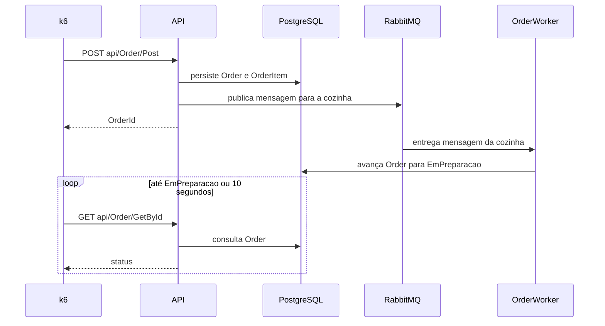

# Linha de base de desempenho com k6

> Este documento contém as decisões necessárias para planejar a implementação. Cada recorte abaixo preserva seu próprio escopo e não deve ser reinterpretado durante o planejamento.
> Estado: confirmado pelo usuário em 27/10/2026.

## Situação

- Projeto: em construção ativa, executado localmente para estudo e sem tráfego de produção.
- Decisão: implementação confirmada pelo usuário em 27/10/2026 durante a descoberta desta funcionalidade.
- Trabalho relacionado: a carga seguirá o fluxo existente de criação e processamento de pedidos pela cozinha. Promoções com IA, controle de capacidade da cozinha e Outbox permanecem documentados separadamente e não fazem parte deste trabalho.
- Risco: o impacto técnico é pequeno e reversível, mas uma linha de base enganosa pode ocultar regressões ou apresentar variações da máquina como defeitos da aplicação.
- Restrição atual: o ambiente em contêiner não publica a porta HTTP da API e `RabbitMqConfig` conecta-se a `localhost`, ignorando o host configurado do RabbitMQ. O teste ponta a ponta isolado não será reproduzível até que esses contratos de execução estejam alinhados.

## Problema

O desenvolvedor não consegue comparar o desempenho do Prensadão entre diferentes alterações e atualmente depende de chamadas manuais à API. Sem uma medição repetível, regressões na persistência do pedido ou no processamento assíncrono da cozinha permanecem invisíveis até se tornarem perceptíveis durante o uso.

Não existe demanda de produção para modelar. O critério que determinou a decisão foi a tolerância, confirmada pelo usuário, de no máximo 20% de degradação em relação a uma linha de base capturada localmente.

## Critérios de sucesso

- Funcionou se a mesma carga de pedidos puder ser repetida localmente com um comando e o teste falhar quando qualquer latência p95 selecionada ultrapassar 120% de sua linha de base.
- O resultado deve indicar se a regressão ocorreu na criação do pedido ou no caminho assíncrono até `EmPreparacao`.
- Está dando errado se o mesmo código produzir resultados instáveis, se uma execução deixar dados duráveis para a próxima ou se respostas HTTP bem-sucedidas esconderem pedidos não processados pela cozinha.
- A linha de base deve ser revisada quando a carga, o ambiente local, o esquema do banco ou a máquina forem alterados de forma relevante.

## Limites

Incluído:

- ambiente local descartável;
- carga sobre a jornada de pedidos;
- calibração da carga;
- captura explícita da linha de base;
- limite de regressão de 20%;
- critérios de correção funcional;
- relatório local legível por pessoa e por ferramenta.

Fora do escopo:

- afirmações de capacidade de produção ou SLO, pois ainda não existe tráfego real;
- integração contínua, até que a repetibilidade local esteja comprovada;
- promoções com IA, porque uma dependência externa e paga prejudicaria a comparação da aplicação;
- atribuição exata a consulta SQL, CPU, memória ou métrica interna do broker, pois isso exige telemetria adicional;
- comportamento de controle de capacidade e Outbox, pois essas funcionalidades ainda não estão implementadas.

Permanecem inalterados os contratos públicos de pedidos, as regras de domínio, o esquema PostgreSQL, a topologia RabbitMQ e as convenções dos testes unitários.

## Referências técnicas

- Os cenários do k6 separam o agendamento da carga da lógica das requisições. Os executores por taxa de chegada mantêm a quantidade solicitada de iterações independentemente do tempo de resposta. Essa abordagem será usada na calibração e na regressão.
- Os `thresholds` do k6 fornecem critérios de aprovação ou falha e código de saída diferente de zero. Métricas com etiquetas permitem aplicar limites separados por operação.
- `setup`, execução dos usuários virtuais e `teardown` possuem ciclos de vida distintos. Como uma falha no `setup` pode impedir o `teardown`, o descarte do ambiente será responsabilidade do comando externo de execução.
- `handleSummary` permite gravar o resultado agregado em JSON sem exigir uma plataforma de métricas.
- Uma estrutura completa com OpenTelemetry, Prometheus e Grafana permitiria investigar causas internas com mais precisão. Essa alternativa não foi escolhida porque o projeto possui um único operador local, não tem SLO de produção e ainda não executa os testes continuamente.

## Desenho escolhido

A funcionalidade será um conjunto de testes de desempenho mantido no repositório, executado contra um ambiente descartável e acompanhado por um registro explícito da linha de base e por um relatório.

Cada execução criará dados válidos, aplicará uma taxa controlada de pedidos, observará a criação e a transição para `EmPreparacao` e avaliará tanto a correção quanto a latência relativa. A aceitação de uma nova linha de base será uma operação explícita, pois atualizá-la automaticamente poderia normalizar uma regressão.

A alternativa mais completa adicionaria OpenTelemetry, Prometheus, Grafana e exportadores de infraestrutura. Ela passa a ser a melhor opção quando os testes forem executados continuamente ou quando for necessário atribuir uma regressão a um processo, consulta ou métrica do broker sem uma investigação manual.

## Decisões principais

1. **Toda execução medida utilizará PostgreSQL e RabbitMQ isolados e descartáveis.** Os dados serão criados por contratos suportados e o ambiente inteiro será removido depois da gravação do relatório. Uma execução anterior não poderá melhorar nem degradar a seguinte.
2. **A primeira carga medirá a criação do pedido e o tempo entre sua criação e a chegada a `EmPreparacao`.** As duas métricas p95 separarão a fronteira síncrona da API e persistência da fronteira assíncrona da cozinha, sem afirmar que identificam a causa interna exata.
3. **A linha de base será capturada apenas por uma operação explícita de aceitação.** Uma execução comum nunca poderá sobrescrevê-la. O registro incluirá a carga, as métricas selecionadas, a data da captura e a identificação do ambiente.
4. **Existe regressão quando qualquer latência p95 selecionada ultrapassar 120% da respectiva linha de base.** A correção funcional não será relativa: a taxa de falhas HTTP deverá permanecer abaixo de 1%, todas as verificações de negócio deverão passar e nenhuma iteração poderá ser descartada.
5. **A regressão utilizará uma taxa constante de chegada escolhida pela calibração, e não uma quantidade fixa de usuários virtuais.** Dessa forma, a taxa de pedidos oferecida permanece comparável mesmo quando o sistema fica mais lento e precisa de mais usuários virtuais.
6. **Calibração e regressão serão perfis separados.** A calibração explorará taxas crescentes. A regressão repetirá uma taxa e uma duração já aceitas, evitando transformar a exploração de capacidade em um critério instável.
7. **O MVP produzirá evidências no console e em JSON, sem adicionar uma plataforma de observabilidade.** Uma falha identificará a fronteira afetada e preservará as medições. A atribuição exata ao PostgreSQL, processo ou RabbitMQ continuará sendo uma etapa posterior de diagnóstico.

## Recortes da funcionalidade

| Recorte | Entrega | Estado |
| --- | --- | --- |
| [Ambiente de desempenho](#ambiente-de-desempenho) | Execução ponta a ponta isolada, acessível e descartável. | Claro |
| [Jornada de pedido](#jornada-de-pedido) | Carga válida e métricas das fronteiras síncrona e assíncrona. | Claro |
| [Calibração e linha de base](#calibração-e-linha-de-base) | Perfil comparável e registro de referência aceito explicitamente. | Claro |
| [Regressão](#regressão) | Critério local de 20% e limites absolutos de correção. | Claro |
| [Relatório](#relatório) | Evidência legível e JSON para comparação posterior. | Claro |

Ordem: Ambiente de desempenho → Jornada de pedido → Calibração e linha de base → Regressão → Relatório.

Responsabilidades já atendidas pelo código atual:

- validação e persistência do pedido: `OrderService`;
- transição executada pela cozinha: `OrderWorker`;
- consulta do pedido: `GET api/Order/GetById`.

Convenções que o planejamento pode derivar do repositório: comandos PowerShell, nomes do Docker Compose, capitalização do JSON e nomenclatura de testes. Devem seguir o runbook e as regras de testes existentes.

### Ambiente de desempenho

**Entrega:** uma API com PostgreSQL e RabbitMQ isolados, que possam ser iniciados, verificados e descartados como um único ambiente de teste. **Estado: claro.**

| Situação | Comportamento esperado | Resultado apresentado |
| --- | --- | --- |
| Dependências ficam prontas | As migrations terminam e a API acessa PostgreSQL e RabbitMQ antes do início da carga. | A verificação de disponibilidade passa e a medição começa. |
| Uma dependência não fica pronta | Nenhuma carga é gerada e nenhuma linha de base é atualizada. | Código de saída diferente de zero e identificação da dependência indisponível. |
| A execução termina ou falha | O relatório é gravado antes da remoção do ambiente e de seus volumes. | O resultado permanece disponível e os dados do teste são descartados. |
| A configuração não corresponde à rede dos contêineres | A execução para durante a verificação inicial. | Falha de configuração, nunca uma falsa regressão de desempenho. |

Alternativa considerada: compartilhar o banco e o broker usados durante o desenvolvimento. Essa alternativa somente vence se preservar os dados entre execuções for mais importante que obter resultados comparáveis.

### Jornada de pedido

**Entrega:** pedidos válidos em uma taxa controlada e medições separadas da criação e do processamento pela cozinha. **Estado: claro.** A decisão principal 2 define as fronteiras observadas.

| Situação | Comportamento esperado | Resultado apresentado |
| --- | --- | --- |
| Preparação dos dados concluída | Um cliente e um produto ativo ficam disponíveis para todas as iterações. | A fase de carga começa com identificadores válidos. |
| Pedido criado | O identificador retornado é registrado e a latência de criação é medida. | Verificação de criação aprovada e métrica `order_create_duration`. |
| Pedido chega a `EmPreparacao` | A latência ponta a ponta é registrada uma vez para aquele pedido. | Verificação da cozinha aprovada e métrica `order_to_preparing_duration`. |
| Pedido não chega a `EmPreparacao` em 10 segundos | A iteração falha e não pode ser apresentada como sucesso rápido. | Verificação de negócio reprovada e tempo limite registrado. |
| Contrato HTTP ou conteúdo enviado é inválido | A resposta falha na verificação específica da operação. | Erro atribuído à rota afetada. |

Alternativa considerada: medir somente `POST api/Order/Post`. Essa alternativa vence se RabbitMQ e `OrderWorker` deixarem de fazer parte do risco de aceitação de pedidos.

### Calibração e linha de base

**Entrega:** uma carga local estável e um registro de referência aceito explicitamente. **Estado: claro.**

| Situação | Comportamento esperado | Resultado apresentado |
| --- | --- | --- |
| Perfil de fumaça | Cinco pedidos sequenciais validam o ambiente e os contratos sem capturar uma linha de base. | Resultado simples de aprovação ou falha. |
| Perfil de calibração | Taxas de 1, 5, 10 e 20 pedidos por segundo são executadas por 60 segundos cada. | Primeira etapa instável e maior etapa estável. |
| Existe uma taxa estável | A taxa de regressão passa a ser 50% da maior etapa estável e roda por 120 segundos. | Carga proposta aguardando aceitação explícita da linha de base. |
| Nenhuma etapa é estável | Nenhuma linha de base é gravada. | Diagnóstico que mostra o primeiro critério reprovado. |
| Aceitação da linha de base solicitada | As métricas aprovadas e a identificação do ambiente substituem o registro de referência. | Nova linha de base marcada claramente como aceita. |

Contrato do registro da linha de base:

| Campo | Significado |
| --- | --- |
| `schemaVersion` | Versão de compatibilidade do contrato do registro. |
| `profile` | Nome, taxa e duração da carga. |
| `orderCreateP95Ms` | p95 aceito para a criação síncrona. |
| `orderToPreparingP95Ms` | p95 aceito para a conclusão assíncrona. |
| `capturedAt` | Instante da captura em UTC. |
| `environment` | Identificação do k6, .NET, sistema operacional e processador. |

Alternativa considerada: manter uma única linha de base universal e independente da máquina. Essa alternativa somente vence quando todas as execuções usam equipamentos controlados e equivalentes.

### Regressão

**Entrega:** uma verificação local repetível contra a linha de base aceita. **Estado: claro.** As decisões principais 3 a 6 definem o contrato.

| Situação | Comportamento esperado | Resultado apresentado |
| --- | --- | --- |
| Linha de base e ambiente são compatíveis | A carga aceita é executada e todos os `thresholds` são avaliados. | Aprovação ou código de saída diferente de zero com as métricas reprovadas. |
| p95 selecionado é menor ou igual a 120% da linha de base | O critério de latência passa. | Valores atual, de referência e máximo permitido. |
| p95 selecionado ultrapassa 120% da linha de base | A execução falha sem alterar a linha de base. | Regressão identificada na fronteira correspondente. |
| Falhas HTTP atingem 1%, uma verificação de negócio falha ou uma iteração é descartada | A execução falha independentemente do histórico de latência. | Falha de correção ou capacidade. |
| Identificação do ambiente mudou de forma relevante | A comparação é recusada até uma nova calibração ser revisada. | Linha de base incompatível, e não uma regressão. |

Alternativa considerada: limites absolutos de latência. Essa alternativa vence quando usuários reais ou um contrato externo definirem tempos de resposta aceitáveis.

### Relatório

**Entrega:** um resumo no console para uso imediato e um resultado JSON para revisão. **Estado: claro.**

| Situação | Comportamento esperado | Resultado apresentado |
| --- | --- | --- |
| Execução aprovada | As duas saídas contêm a carga, os limites e as medições selecionadas. | Código de saída zero e comparação marcada como aprovada. |
| Um `threshold` falha | As duas saídas preservam os valores atual, de referência e máximo permitido. | Código de saída diferente de zero e fronteira afetada. |
| Execução interrompida antes da medição | O resultado parcial não pode ser aceito como linha de base. | Falha de infraestrutura ou preparação separada da falha de desempenho. |

Alternativa considerada: painéis Grafana com armazenamento histórico de métricas. Essa alternativa vence quando os resultados vierem de várias máquinas ou precisarem ser correlacionados continuamente com telemetria da aplicação e da infraestrutura.

## Fontes

- `docs/GLOSSARY.md`: significado canônico de pedido, cozinha e status do pedido.
- `docs/ARCHITECTURE.md`: responsabilidades de execução e limites entre camadas.
- `docs/FEATURES.md`: comportamento atual dos pedidos, mensageria e workers.
- `docs/RUNBOOK.md`: execução local suportada e fluxo do Docker Compose.
- `docs/features/rabbitmq-message-reliability.md`: comportamento implementado de filas e dead-letter.
- `docs/features/order-status-outbox.md`: comportamento futuro de confiabilidade excluído deste escopo.
- [Ciclo de vida dos testes k6](https://grafana.com/docs/k6/latest/using-k6/test-lifecycle/): restrições de `setup`, usuários virtuais, `teardown` e inicialização.
- [Taxa de chegada constante do k6](https://grafana.com/docs/k6/latest/using-k6/scenarios/executors/constant-arrival-rate/): comportamento do modelo aberto de carga.
- [Thresholds do k6](https://grafana.com/docs/k6/latest/using-k6/thresholds/): critérios de aprovação, métricas com etiquetas e código de saída.
- [Resumo personalizado do k6](https://grafana.com/docs/k6/latest/results-output/end-of-test/custom-summary/): contrato para o resumo local em JSON.
