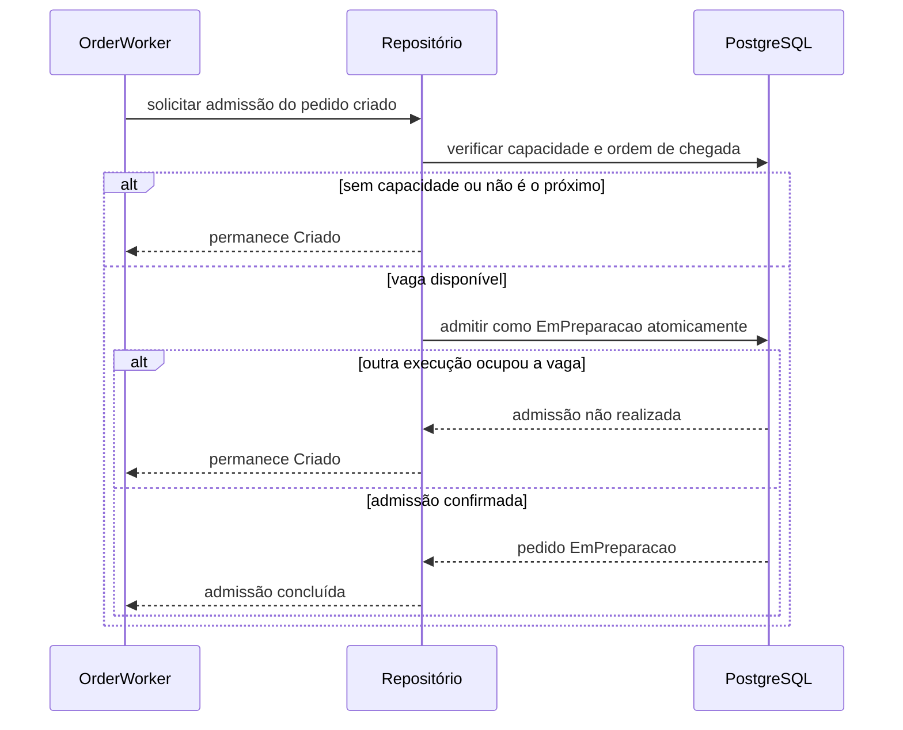

# Controle de Admissão da Cozinha

> Plan from this document. Each slice below carries its own shape - copy it, do not re-derive it.
> Status: confirmed by Alyson, 2026-10-21

## Situation

- Project: in active construction.
- Decision: committed by Alyson em 2026-10-21 nesta descoberta.
- In flight: preserva o fluxo atual de pedidos e dá ao `OrderWorker` a responsabilidade de admitir pedidos na capacidade da cozinha; confiabilidade RabbitMQ permanece na feature separada `docs/features/rabbitmq-message-reliability.md`.
- At stake: uma regra incorreta pode iniciar pedidos acima da capacidade real ou recusar pedidos durante o horário de funcionamento.

## Problem

O sistema inicia todo pedido automaticamente, sem representar o limite de trabalho simultâneo da cozinha. Isso impede que o status `EmPreparacao` corresponda ao que a cozinha realmente consegue preparar; o volume real ainda não é medido porque o projeto está em construção.

## Success

- Worked if: a quantidade de pedidos em `EmPreparacao` nunca ultrapassa o limite configurado e os pedidos em espera são admitidos por ordem de chegada.
- Going wrong: ultrapassagem do limite, pedido mais novo admitido antes de um mais antigo ou recusa incorreta durante o horário configurado.
- Review: quando os testes concorrentes e o primeiro fluxo operacional completo estiverem disponíveis — responsável pelo projeto.

## Boundary

In: limite global de pedidos em preparação, admissão automática por chegada, permanência em `Criado` durante a espera, cancelamento durante a espera e um intervalo de atendimento por dia.

Out: retry, DLQ e recuperação RabbitMQ — pertencem ao design de confiabilidade; aceite manual por gestor — não existe ator autenticado; tempo máximo de espera, feriados, datas excepcionais e múltiplos intervalos diários — evoluções posteriores.

Unchanged: `OrderStatusEnum`; pedidos prontos, em entrega, finalizados ou cancelados não ocupam capacidade.

## Shape

A configuração da cozinha define o limite global e o intervalo de aceitação de pedidos no fuso `America/Sao_Paulo`. A criação recusa novos pedidos fora do horário, enquanto pedidos já criados continuam o fluxo. O `OrderWorker` admite o pedido `Criado` mais antigo somente quando existe capacidade, preservando o limite mesmo com processamento concorrente. A configuração persistida substitui a configuração operacional quando houver necessidade confirmada de alterações durante o expediente.

## Key decisions

1. **Somente pedidos em `EmPreparacao` ocupam capacidade.** `Pronto` e os estados posteriores pertencem a outros processos operacionais.
2. **Um pedido sem capacidade permanece em `Criado`.** O estado já significa que o pedido foi registrado e ainda não foi iniciado, e continua permitindo cancelamento.
3. **A admissão é automática e respeita a ordem de criação.** Não existe aceite manual nem prioridade diferente no MVP.
4. **O limite é único e global.** Reduzi-lo abaixo da ocupação atual não interrompe pedidos; apenas bloqueia novas admissões até a ocupação ficar abaixo do limite.
5. **O horário impede somente a criação de novos pedidos.** Pedidos aceitos antes do fechamento continuam aguardando ou sendo processados depois dele.
6. **O MVP possui um intervalo por dia e permite atravessar a meia-noite.** Múltiplos intervalos e exceções de calendário ficam fora desta entrega.
7. **A verificação da vaga e a admissão formam uma única decisão concorrente.** Duas execuções simultâneas não podem ocupar a mesma última vaga.

## Work

| Slice | Delivers | Status |
|---|---|---|
| [Horário de atendimento](#horário-de-atendimento) | Novos pedidos são aceitos somente no intervalo configurado. | clear |
| [Capacidade da cozinha](#capacidade-da-cozinha) | Limite global observável sem interromper trabalho em andamento. | open — configuração operacional adotada como padrão do MVP |
| [Admissão automática](#admissão-automática) | Pedidos `Criado` entram em `EmPreparacao` por ordem de chegada quando há vaga. | clear |

Order: Horário de atendimento → Capacidade da cozinha → Admissão automática.

Already handled by existing code: cancelamento em `Criado` → `Order`; avanço `Criado` para `EmPreparacao` → `Order`.

Derivable from the repository, left to the plan: validação de DTOs, injeção de dependência, persistência e testes seguem as regras em `docs/rules/`.

### Horário de atendimento

**Delivers** a regra de aceitação de novos pedidos no horário local da lanchonete. **Status: clear.**

| State | What should happen | Caller sees |
|---|---|---|
| Dentro do intervalo | O pedido é criado normalmente. | `200` com o identificador do pedido. |
| Fora do intervalo | Nenhum pedido ou item é persistido. | `400` informando que a lanchonete está fora do horário de atendimento. |
| Intervalo atravessa meia-noite | O período contínuo permanece aberto até o horário final do dia seguinte. | Mesmo contrato dos demais horários. |
| Horário encerra com pedidos existentes | Os pedidos existentes permanecem válidos e continuam o fluxo. | Nenhuma alteração nos pedidos aceitos. |

`POST api/Order/Post` `OrderRequestDto` → `200` identificador do pedido.

Alternatives considered: calendário com múltiplos intervalos e exceções — vence quando a operação precisar de pausas diárias ou feriados configuráveis.

### Capacidade da cozinha

**Delivers** uma configuração global de ocupação máxima e horário semanal. **Status: open.**

| State | What should happen |
|---|---|
| Ocupação abaixo do limite | Existe vaga para admitir o próximo pedido. |
| Ocupação igual ou acima do limite | Nenhum novo pedido entra em `EmPreparacao`. |
| Limite reduzido abaixo da ocupação | Pedidos em andamento permanecem; novas admissões aguardam. |

Alternatives considered: configuração persistida — vence quando capacidade ou horário precisarem mudar durante o funcionamento sem reinicialização.

1. Onde a configuração reside — padrão do MVP: configuração operacional validada na inicialização.

### Admissão automática

**Delivers** o uso efetivo da capacidade pelo pedido mais antigo elegível. **Status: clear.** É a porta concorrente da feature.

| State | What should happen |
|---|---|
| Pedido `Criado` e existe vaga | O pedido mais antigo passa para `EmPreparacao`. |
| Pedido `Criado` e não existe vaga | Permanece em `Criado`, sem ser tratado como falha. |
| Pedido `Criado` é cancelado | Sai da espera e nunca ocupa vaga. |
| Pedido deixa `EmPreparacao` | A vaga liberada permite admitir o próximo pedido elegível. |
| Entregas concorrentes disputam a última vaga | Apenas uma admissão vence; o limite não é ultrapassado. |

Alternatives considered: remoção do `OrderWorker` e início manual — vence se a operação passar a exigir aceite humano da cozinha.

## Sources

- `docs/GLOSSARY.md` — significado dos estados do pedido, da fila da cozinha e do consumidor.
- `docs/FEATURES.md` — fluxo de pedidos e workers existente.
- `docs/ARCHITECTURE.md` — limites entre Domain, Application e Infra.

