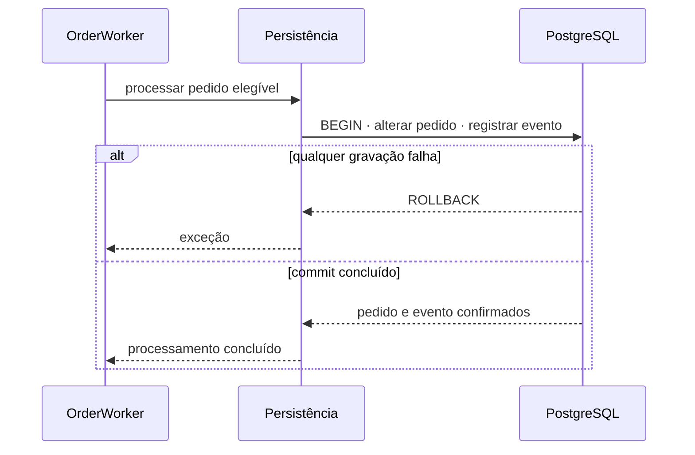

# Outbox de Alteração de Status do Pedido

> Plan from this document. Each slice below carries its own shape - copy it, do not re-derive it.
> Status: confirmed by Alyson, 2026-10-21; business rules and recovery policy remain open

## Situation

- Project: in active construction.
- Decision: separar a atomicidade do `OrderWorker` em uma feature própria, confirmada por Alyson em 2026-10-21.
- In flight: a admissão da cozinha está em `docs/features/kitchen-admission-control.md`; a quarentena RabbitMQ está em `docs/features/rabbitmq-message-reliability.md`.
- At stake: uma falha entre persistência e publicação pode deixar o pedido em um status que os demais consumidores nunca receberam.

## Problem

O `OrderWorker` persiste `EmPreparacao` e depois publica `OrderStatusChangedMessageDto`. Uma falha entre as operações deixa o estado do PostgreSQL à frente do RabbitMQ; inverter a ordem apenas deixa o RabbitMQ à frente do PostgreSQL.

## Success

- Worked if: toda alteração confirmada de status possui exatamente um evento durável elegível para publicação, inclusive após falha ou reinicialização.
- Going wrong: pedido atualizado sem evento, evento emitido para atualização revertida ou duplicação de efeito nos consumidores.
- Review: antes de integrar a capacidade da cozinha ao `OrderWorker` — responsável pelo projeto.

## Boundary

In: registro Outbox, atomicidade com a alteração do pedido, despacho confirmado, idempotência e recuperação de publicação pendente.

Out: capacidade e horário da cozinha — feature própria; roteamento para DLQ da mensagem de entrada — já definido; notificações externas — não existem no modelo atual.

Unchanged: sequência pública de `OrderStatusEnum` e contratos HTTP de pedido.

## Shape

A alteração do pedido e o registro do evento correspondente são confirmados na mesma transação PostgreSQL. Um despachante publica eventos pendentes e só os considera publicados após confirmação do RabbitMQ, sem incluir o broker na transação do banco. A mensagem de entrada pode receber `ack` depois do commit porque a publicação futura ficou registrada de forma durável. Remover o evento de status é a alternativa mais simples e vence se nenhum consumidor real precisar dele.

## Key decisions

1. **Alteração do pedido e criação do evento Outbox são atômicas.** Não existe pedido atualizado sem registro durável do evento correspondente.
2. **RabbitMQ não participa da transação PostgreSQL.** A publicação acontece depois do commit e usa confirmação própria do broker.
3. **Falha de publicação mantém o evento pendente.** Não reverte o pedido nem transforma o processamento de entrada já confirmado em falha.
4. **A publicação é idempotente do ponto de vista dos consumidores.** Uma confirmação perdida pode causar nova publicação e não pode repetir o efeito de negócio.
5. **As regras de capacidade são avaliadas antes da alteração atômica.** Cozinha cheia permanece um resultado normal, sem evento de `EmPreparacao`.

## Work

| Slice | Delivers | Status |
|---|---|---|
| [Evento Outbox](#evento-outbox) | Registro durável associado à alteração de status. | rfc |
| [Processamento do pedido](#processamento-do-pedido) | Commit único da alteração e do evento. | open — regras detalhadas do worker serão decididas com a capacidade |
| [Despacho do evento](#despacho-do-evento) | Publicação confirmada e marcação do evento. | rfc |
| [Recuperação](#recuperação) | Tratamento de eventos pendentes e duplicados. | open — automático ou operacional ainda não decidido |

Order: Evento Outbox → Processamento do pedido → Despacho do evento → Recuperação.

Already handled by existing code: transição de status → `Order`; publicação RabbitMQ → `IMessagePublisher`; consumo da alteração → `OrderStatusMessageWorker`.

Derivable from the repository, left to the plan: entidade no Domain, persistência na Infra, orquestração na Application/worker e testes unitários sem infraestrutura real.

### Evento Outbox

**Delivers** a representação persistida de um evento ainda não publicado. **Status: rfc.**

- RFC: conteúdo, identidade, estados, retenção e unicidade do evento — bloqueia idempotência e recuperação. Not decided.

### Processamento do pedido

**Delivers** a invariância entre status e evento. **Status: open.** É a porta transacional da feature.

| State | What should happen |
|---|---|
| Pedido elegível | Alteração e evento são confirmados juntos. |
| Falha antes do commit | Alteração e evento são revertidos; a exceção segue para o consumidor. |
| Pedido duplicado já processado | Nenhuma nova alteração; o evento previamente registrado permanece a fonte da publicação. |
| Cozinha sem capacidade | Pedido permanece `Criado` e nenhum evento de preparação é criado. |

1. Resultado quando o pedido não existe — padrão atual: falha definitiva encaminhada à DLQ da cozinha.

### Despacho do evento

**Delivers** publicação independente da transação do pedido. **Status: rfc.**

| State | What should happen |
|---|---|
| Evento pendente e broker confirma | Evento é marcado como publicado. |
| Broker não confirma | Evento continua pendente. |
| Confirmação ocorre e marcação falha | Nova publicação pode ocorrer; consumidor precisa ser idempotente. |

- RFC: publisher confirms, concorrência entre despachantes e lote de publicação — bloqueia a implementação segura. Not decided.

### Recuperação

**Delivers** retomada de eventos que não chegaram ao broker. **Status: open.**

| State | What should happen |
|---|---|
| Evento permanece pendente | Continua visível para diagnóstico e recuperação. |
| Evento é publicado mais de uma vez | O efeito final continua único. |

1. Nova tentativa automática ou liberação operacional — sem padrão tomado; será decidido antes da implementação.

## Sources

- `docs/GLOSSARY.md` — significado dos pedidos, status e mensagens.
- `docs/ARCHITECTURE.md` — direção das dependências e responsabilidades.
- `docs/rules/02-persistencia.md` — regras de persistência e migrations.
- `docs/rules/04-mensageria.md` — regras de publishers, consumers e workers.

