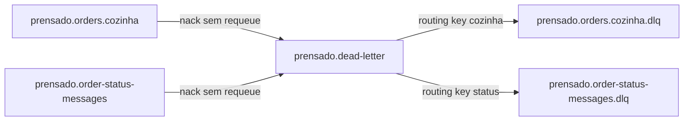

# Dead-letter da Mensageria RabbitMQ

> Plan from this document. Each slice below carries its own shape - copy it, do not re-derive it.
> Status: confirmed by Alyson, 2026-10-21

## Situation

- Project: in active construction.
- Decision: DLQ sem retry automático e separada por fluxo, confirmada por Alyson em 2026-10-21.
- In flight: o protótipo local já declara as DLQs e rejeita falhas sem requeue; atomicidade do `OrderWorker` pertence à feature `docs/features/order-status-outbox.md`.
- At stake: roteamento incorreto pode perder mensagens problemáticas ou misturar falhas de processos com procedimentos de recuperação diferentes.

## Problem

Uma exceção no consumidor não possuía encerramento explícito, deixando a entrega sem `ack` ou `nack` e sem local conhecido para diagnóstico. O projeto precisa isolar mensagens inválidas ou não processadas sem criar ciclos automáticos de tentativas.

## Success

- Worked if: toda exceção de processamento resulta em rejeição sem requeue e a mensagem chega à DLQ correspondente à fila de origem.
- Going wrong: mensagem retorna à fila principal, chega à DLQ errada ou desaparece sem confirmação nem quarentena.
- Review: quando a primeira integração externa exigir política de retry ou replay automatizado — responsável pelo projeto.

## Boundary

In: exchange de dead-letter, duas DLQs duráveis, bindings por origem, `ack` após sucesso, `nack` sem requeue após exceção e logging da falha.

Out: retry automático — não necessário no MVP; Outbox e atomicidade entre PostgreSQL e RabbitMQ — feature própria; monitoramento, retenção e replay assistido — evolução operacional; capacidade cheia — fluxo normal da cozinha.

Unchanged: contratos `OrderMessageDto` e `OrderStatusChangedMessageDto`.

## Shape

Um exchange direto de dead-letter recebe rejeições das filas principais e usa routing keys distintas para preservar o processo de origem. Cada fila principal possui sua própria DLQ durável, e o consumidor confirma somente handlers concluídos. Qualquer exceção ou payload desserializado como nulo recebe `nack` sem requeue, sem tentativas automáticas no MVP. Uma política com retry passa a vencer somente quando surgir uma integração cuja indisponibilidade temporária justifique novas tentativas automáticas.

## Key decisions

1. **O MVP não possui retry automático.** Falhas transitórias e definitivas seguem para a DLQ e são diferenciadas durante o diagnóstico.
2. **Cada fluxo possui sua própria DLQ.** Cozinha e mensagem de status têm contratos, causas e destinos de recuperação diferentes.
3. **As DLQs compartilham um exchange direto.** Routing keys distintas preservam a separação sem duplicar exchanges.
4. **O consumidor envia `ack` somente após o handler concluir.** Exceção ou payload nulo recebe `nack` com `requeue: false`.
5. **Entrega duplicada sem efeito pendente não é falha.** Ela é confirmada sem repetir a alteração.
6. **Falta de capacidade da cozinha não é falha técnica.** O pedido permanece em `Criado` conforme `docs/features/kitchen-admission-control.md`.
7. **DLQ é quarentena.** O MVP não executa retorno automático à fila principal.

## Work

| Slice | Delivers | Status |
|---|---|---|
| [Topologia de dead-letter](#topologia-de-dead-letter) | Exchange direto, duas DLQs e bindings por origem. | clear |
| [Confirmação do consumidor](#confirmação-do-consumidor) | `ack` no sucesso e `nack` sem requeue na falha. | clear |
| [Diagnóstico operacional](#diagnóstico-operacional) | Identificação da fila de origem e causa técnica nos logs. | clear |

Order: Topologia de dead-letter → Confirmação do consumidor → Diagnóstico operacional.

Already handled by existing code: serialização JSON → publisher existente; idempotência básica de pedido já avançado → `OrderWorker`.

Derivable from the repository, left to the plan: nomes centralizados em `RabbitMqConstants`, workers na Infra e testes sem broker real.

### Topologia de dead-letter

**Delivers** isolamento físico das falhas de cozinha e mensagem de status. **Status: clear.**

| State | What should happen |
|---|---|
| Rejeição em `prensado.orders.cozinha` | Encaminhar para `prensado.orders.cozinha.dlq`. |
| Rejeição em `prensado.order-status-messages` | Encaminhar para `prensado.order-status-messages.dlq`. |
| Reinicialização do RabbitMQ | Exchanges, filas e mensagens persistentes sobrevivem conforme as garantias do broker. |

Alternatives considered: um exchange e uma fila compartilhada — vence somente se os processos tiverem o mesmo contrato e procedimento de recuperação.

### Confirmação do consumidor

**Delivers** encerramento explícito de cada entrega. **Status: clear.**

| State | What should happen |
|---|---|
| Handler concluído | Enviar `ack`. |
| Payload nulo | Registrar erro e enviar `nack` sem requeue. |
| Handler lança exceção | Registrar erro e enviar `nack` sem requeue. |
| Canal já fechado | O consumidor não tenta enviar confirmação por um canal inválido. |

### Diagnóstico operacional

**Delivers** informação mínima para localizar a falha. **Status: clear.**

| State | What should happen |
|---|---|
| Falha do handler | Log estruturado contém exceção e fila de origem. |
| Mensagem na DLQ | Headers do RabbitMQ preservam o histórico de dead-letter. |
| Causa corrigida | Reprocessamento permanece manual e fora do MVP. |

## Sources

- `docs/GLOSSARY.md` — significado das mensagens, filas e consumidores.
- `docs/FEATURES.md` — comportamento dos publishers e workers.
- `docs/rules/04-mensageria.md` — limites obrigatórios para mensageria e workers.
- `docs/RUNBOOK.md` — operação e migração da topologia RabbitMQ.

